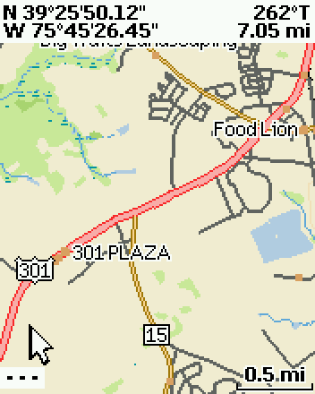
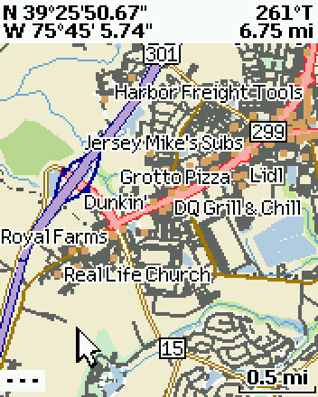
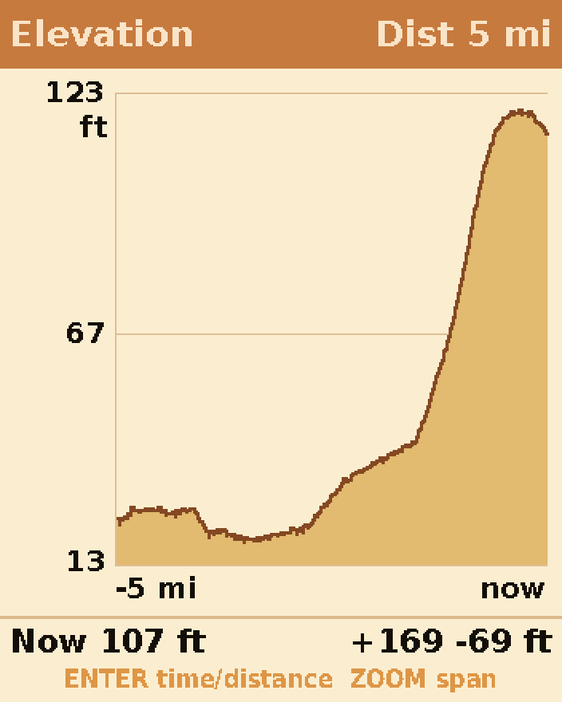
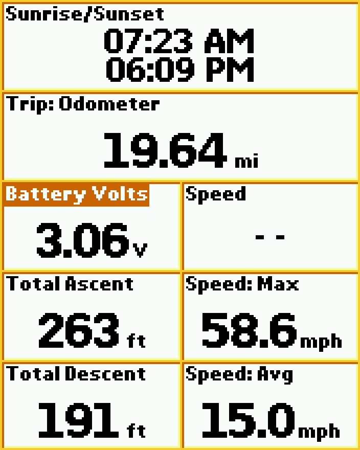

# PN-40 mods

Custom firmware mods for the **DeLorme Earthmate PN-40** handheld GPS (firmware
2.9.6.70319). These mods add C code to the stock firmware, linked into unused NOR flash and
hooked in with small, checked patches. The repo also holds the reverse-engineering notes,
the bootloader analysis and the tools behind them. [Screenshots](#screenshots) below.

## What it adds

- **GPS week-rollover fix**: stock units show dates 19.6 years in the past since 2018.
  The fix maps weeks onto 2017-11-19 .. 2037-07-04.
- **Data fields**: Battery Voltage, Total Ascent and Total Descent. The totals use a
  3 m deadband (10 m on GPS elevation) and a 15 m/s jump guard against calibrations.
  They are saved with the trip.
- **Elevation profile page** (replaces Hunt/Fish): elevation over time or distance for
  the last 12 hours. ENTER switches the view and ZOOM changes the span.
- **NMEA logger**: logs the GPS output to `SD:\nmea\` while that folder exists.
- **Diagnostics** written on every screenshot: UI timing (`maptime.txt`), an IRQ-sampled
  CPU profile (`cpuprof.txt`, while `SD:\prof` exists), and a system report
  (`sysinfo.txt`) with the measured CPU clock, the bus timing, a CPU and memory stress
  test, compass counters and register dumps.
- **CPU overclock**: 117 MHz stock -> 234 MHz, set at boot (see the warnings below).
- **Black box**: records shutdowns, watchdog resets and CPU faults with their causes, and the
  record survives the reset.
- **Delta updates**: the build can write a file that holds only the 64 KB flash blocks that
  changed, which makes an install much faster.
- **Maps from public data** ([`mapgen/`](mapgen/README.md)): NAIP aerial imagery, USGS Topo or
  a GeoTIFF, turned into the PN-40's raster map format; and up-to-date vector maps (roads,
  names, route shields, water, points of interest) from OpenStreetMap, in DeLorme's
  vector format. The maps install into the built-in base map folder, which the mods
  build moves to `SD:\basedata` so the card's size is the limit.

## Screenshots

All taken on the PN-40 with its own screenshot button.

### Up-to-date maps: Middletown, Delaware

| DeLorme Topo 10 (about 2010) | OpenStreetMap (October 2026), `mapgen/make_vector.py` |
|---|---|
|  |  |

The same spot at the same zoom (0.5 mi scale), just west of Middletown, Delaware. Left
is DeLorme's own Topo 10 map, whose data dates from around 2010. Right is a
map this project builds from current OpenStreetMap data in DeLorme's own format, so the
unit draws it with its own colours, label fonts, route shields and icons.

Middletown has grown a lot since 2010, and only the new map shows it:
- **Roads:** the US 301 toll road (opened 2019) runs through the middle of the new
  map; the old map only has the old US 301 (red, left) and empty land.
- **Neighbourhoods:** most of the subdivisions east of the toll road, and the streets
  inside them, aren't on the old map.
- **Places:** the businesses along DE 299 (Lidl, Royal Farms, Dunkin', Jersey Mike's,
  Grotto Pizza and others) appear with DeLorme's icons. The old map shows a few
  businesses from its 2010 directory (Food Lion, 301 Plaza).

Map data on the right (c) OpenStreetMap contributors (ODbL). See
[`mapgen/README.md`](mapgen/README.md) for how the maps are made.

### Elevation profile page



A new page (it takes the place of Hunt/Fish): the elevation over the last 5 miles
travelled, with "now" at the right edge. The scale fits itself to the data (here 13 to
123 ft) and is never less than 20 m tall, so GPS noise doesn't look like hills. The bottom
line shows the current elevation (107 ft) and the trip's total ascent and descent (+169
/ -69 ft). ENTER switches between distance and time (the last 30 minutes to 12 hours),
and ZOOM changes the span. The unit records a point every 12 seconds, whether the page is
showing or not.

### New data fields



Three data fields the stock firmware doesn't have, here on a page next to stock fields:
- **Battery Volts** (3.06 V): the battery voltage the unit measures, more useful than
  the stock four-step battery icon for judging how much is left.
- **Total Ascent / Total Descent** (263 / 191 ft): how much the trip has climbed and
  dropped. A deadband (3 m, or 10 m when the elevation comes from GPS) keeps noise
  from adding up, and a jump guard ignores barometer recalibrations. The totals are
  saved with the trip.

## Layout

| Path | What |
|---|---|
| [`mods/`](mods/README.md) | The mods: C/assembly sources, `build.py`, emulator tests (unicorn), `pnhex.py`. **Start here.** |
| [`nor/BOOTLOADER.md`](nor/BOOTLOADER.md) | Bootloader analysis: NOR layout, boot flow, how updates are validated and flashed |
| `nor/nor_8MB.bin` | Full 8 MB NOR dump (bootloader + firmware), read out with `bootdump/` |
| `bootdump/` | `make_bootdump.py`: a firmware whose screenshot button dumps the whole NOR to SD |
| `patched/` | `make_patch.py`: the week-rollover fix on its own, plus its output |
| `update/PN-40.hex` | Stock firmware 2.9.6.70319, the input to every build |
| [`mapgen/`](mapgen/README.md) | `.pm0` map reader/writer, raster and vector generators; format notes in [re/notes/pm0.md](re/notes/pm0.md) and [re/notes/vector.md](re/notes/vector.md) |
| [`re/`](re/UI.md) | Reverse engineering: Ghidra scripts, function/string tables, name tables, notes on [pages](re/notes/pages.md), [layers](re/notes/layers.md), [graphics](re/notes/graphics.md), [settings](re/notes/settings.md) |

## Build

Needs `arm-none-eabi-gcc` (MSYS2: `mingw-w64-x86_64-arm-none-eabi-gcc`) and Python 3
with `unicorn` (and `capstone` for disassembly work).

```
cd mods
python build.py ../update/PN-40.hex      # -> out/PN-40.hex
python test_nmealog.py                   # plus test_ascent.py, test_profile.py, test_prof.py, test_pnhex.py
```

`build.py` refuses to write anything unless:
- every patch finds the stock bytes it expects;
- every hex line stays out of the bootloader and the identity/marker blocks;
- the bootloader's own line parser, run in an emulator from the NOR dump, accepts every
  changed line.

See [`mods/README.md`](mods/README.md) for every patch, address and design decision.

## Install

1. Copy `mods/out/PN-40.hex` to `SD:\update\PN-40.hex`. The `update\0\` base-data folder
   isn't needed, and leaving it out makes the install much faster.
2. Eject the card, unplug the USB cable and power-cycle the unit.

The bootloader validates the file and then flashes it.

To go back, do the same with `update/PN-40.hex` (stock) or `patched/PN-40.hex` (date
fix only). Before rolling back, remove any of the new data fields (ids 161-163) from your
pages first, or the older firmware will likely crash drawing them.

## Warnings

- **Use at your own risk.** This writes your device's flash. The bootloader is never
  touched (the build refuses to), so a bad firmware can always be replaced from the SD
  card with a card reader.
- **Overclock:** above the stock clock the unit shuts down when "Connect to Computer"
  exports the SD card over USB, so copy files with a card reader instead (the black box in
  `mods/bbox.c` is there to find out why). Set `CPU_CLOCK = None` in `mods/build.py` for the
  stock clock. 234 MHz passed the stress test; one report line once came out corrupted.
- The local `baseline_*` rollback copies that `mods/README.md` mentions aren't in the repo.
  Build from `update/PN-40.hex` instead.

## Regenerating the decompilation

The Ghidra project and its 13 MB decompiler output (`re/out/decomp.c`) aren't in the repo.
To rebuild them with [Ghidra](https://ghidra-sre.org/) 11.1.2 (Git Bash on Windows works):

```
cd re
python make_inputs.py ../update/PN-40.hex           # fw_stock.bin, ram_code.bin, ram_data.bin (already included)
GHIDRA=/path/to/ghidra_11.1.2_PUBLIC sh analyze.sh  # import at 0x30080000 as ARM:LE:32:v5t + auto-analysis, ~1 h
GHIDRA=/path/to/ghidra_11.1.2_PUBLIC sh run_export.sh 6   # apply names.tsv, decompile in 6 parallel workers
sh fn.sh 30085e14                                   # print one function from out/decomp.c
```

- `analyze.sh` creates `re/proj`. The `pn40_setup.py` pre-script adds the RAM blocks
  the startup code fills, and seeds about 11,000 functions from `seeds.txt`.
- `pn40_thumb.py` then fixes the Thumb functions behind ARM->Thumb veneers.
- `run_export.sh` applies `names.tsv` (the functions identified so far) and writes
  `out/decomp.c`, `out/functions.tsv` and `out/strings.tsv`.

You can also open `re/proj` in the Ghidra GUI after `analyze.sh`.

## Legal

The original code and notes here are MIT-licensed (see [LICENSE](LICENSE)). The firmware and
bootloader images are DeLorme's and are included only for interoperability and research.
This project isn't affiliated with DeLorme or Garmin.
