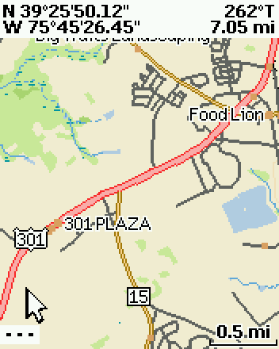
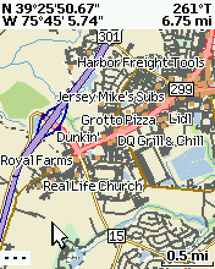

# mapgen: PN-40 maps from public data

Makes map packages (`.pm0`) the PN-40 can show.

**Raster maps** (`make_map.py`), all public domain:
- **NAIP aerial imagery** (USDA, via USGS The National Map, about 0.3-0.6 m source);
- the **USGS Topo** base map (The National Map);
- any **GeoTIFF** in EPSG:4326, or in another EPSG projection if `pyproj` is installed.

**Vector maps** (`make_vector.py`) from **OpenStreetMap** (ODbL; credited in the map):
roads with names and route shields, trails, railways, water and coastline, woods,
wetlands, parks, towns and points of interest, in DeLorme's own classes, colours and
icons. Geofabrik's state extracts make a whole region in one run (Delaware, Maryland,
New Jersey and Pennsylvania: 190 MB in three files, 23 minutes).

The formats are documented in [`../re/notes/pm0.md`](../re/notes/pm0.md) (container,
raster) and [`../re/notes/vector.md`](../re/notes/vector.md).

## Comparison: Middletown, Delaware

The same spot and zoom on the PN-40: DeLorme's Topo 10 data from around 2010, and a
map built by `make_vector.py` from OpenStreetMap in October 2026. The new US 301 toll
road, the subdivisions and the businesses built since then are only on the new map.

| DeLorme Topo 10 (about 2010) | OpenStreetMap (2026), `make_vector.py` |
|---|---|
|  |  |

Map data on the right (c) OpenStreetMap contributors.

## Use

Needs Python 3 with numpy, Pillow and tifffile.

```
python make_map.py My_Area --bbox -75.65 39.4333 -75.6167 39.45 --source naip
python make_map.py My_Area --bbox -75.65 39.4333 -75.6167 39.45 --source topo
python make_map.py My_Area --bbox W S E N --source scan.tif [--kind topo]
```

Vector maps from OpenStreetMap (needs shapely and osmium):

```
python make_vector.py Delaware_OSM --geofabrik north-america/us/delaware
python make_vector.py My_Area --geofabrik north-america/us/delaware --bbox W S E N
python make_vector.py My_Area --bbox W S E N          (Overpass API, up to 1 square degree)
```

Geofabrik extracts are downloaded once into `out/cache/`; delete them there to refresh.

- **Output:** `out/My_Area-CDOQQ-MAP.pm0` (aerial) or `out/My_Area-3DTQ-Map.pm0` (topo),
  plus `_preview.png`.
- **Self-check:** the script parses the file back and compares every tile's pixels with
  the source.
- **Downloads** are cached in `out/cache/`. The USGS servers often return 502/504; the
  script retries.
- **Size:** about 1.5 MB per km² for aerials (Thomas Cove, 2.9 × 1.9 km, is 8.1 MB).

## Install on the PN-40

Generated maps have no DeLorme licence record. The firmware only loads them from the
built-in base map folder, which it never licence-checks. Copying one to `SD:\maps` or the
internal drive gives "Map not updated for use with this PN-40".

**With the mods build (`BASEDATA_ON_SD`, see `../mods/README.md`)** the base map folder is
`SD:\basedata`. Copy the stock base maps there once (from `dumps\internal0_files\basedata`),
then copy generated maps in next to them and restart the unit. The card's size is the limit.

**Stock firmware:** the folder is `MSYS0:/basedata` (about 85 MB free), reached through the
bootloader:

1. Copy the `.pm0` to `SD:\update\0\basedata\` on the SD card. Don't leave a `PN-40.hex` in
   `SD:\update\` unless you mean to flash it.
2. Power-cycle with the card in. The bootloader's partition update copies the file into
   `MSYS0:/basedata` ("Updating ..."). The copy stays on the card. Leaving it there is
   harmless: the bootloader skips files whose size and first 512 bytes match the device
   copy. To update a map, copy the new build over it (each build has a new timestamp).

To **remove** a map, put an empty (0-byte) file with the same name in
`SD:\update\0\basedata\` and power-cycle; the bootloader deletes the device copy. This comes
from the bootloader code (pass 1 of RAM 0x7A4C, "Deleting %s") and hasn't been tried on the
unit yet. It should also work if a map ever stops the unit from starting, because the
bootloader runs before the firmware.

## Files

| File | What |
|---|---|
| `pm0.py` | read/write `.pm0` maps: container, page 0, RI index, raster tiles and RLE, vector pages |
| `make_map.py` | raster generator (NAIP, USGS Topo, GeoTIFF) |
| `make_vector.py` | vector generator from OpenStreetMap (roads, trails, rail, power lines, water and coastline, woods, wetlands, parks, names, route shields, towns, points of interest; no search yet; needs shapely) |
| `pm0view.py` | render a layer of any raster `.pm0` (DeLorme's too) to PNG |
| `test_pm0.py` | byte-exact round trip of every DeLorme raster map in `../internal drive/maps` |
| `test_pm0v.py` | byte-exact round trip of the DeLorme vector maps in `../dumps` (base maps, Topo 10) |
| `test_make_map.py` | offline generator tests: synthetic GeoTIFFs, layout rules, georeferencing |

## Layout choices

They copy DeLorme's maps. Aerials get levels 15/13/11 (1.2/4.8/19 m pixels), topo 14/12
(2.4/9.5 m), with the same zoom ranges, labels (`COLOR DOQQ`, `3DTQ`; the label sets the
draw order), page numbering, empty search indices and tile splitting. The finest level is
fetched at 2× and averaged down; each coarser level is an exact 4×4 average of the one
below.
